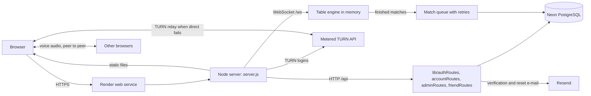
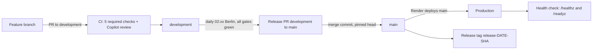
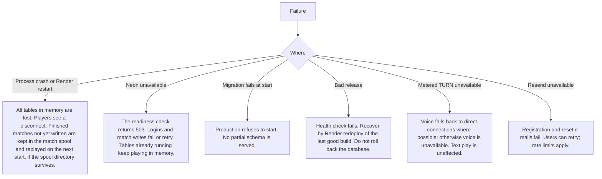

# Tableverse technical architecture

This is the single source of truth for how Tableverse works, why each part exists, how security is applied and how the system
is operated. It describes the code as it is on `development` at the time of writing. Where a control is planned, not running, it
is labelled so.

Status labels used throughout:

- **IMPLEMENTED**: in the code and covered by a test or a workflow check.
- **PARTIAL**: in the code, with a known gap listed next to it.
- **MANUAL**: depends on a setting in GitHub, Render, Neon or another provider that the repository cannot verify.
- **NOT IMPLEMENTED**: planned or absent. Never described as active.

Where a provider price, plan limit or backup setting is not verified from the code or from a provider page, it is marked
**unverified**. Runbooks are linked, not repeated here.

Related documents: `docs/LOCAL_DEVELOPMENT.md`, `docs/RELEASES.md`, `docs/OPERATIONS_RUNBOOK.md`, `docs/ADMIN.md`,
`docs/ADMIN_CONSOLE_AUDIT.md`, `docs/ACCOUNT_DELETION_AND_RETENTION.md`, `docs/DATA_CLEANUP.md`, `docs/PRIVATE_TABLES.md`,
`docs/SESSION_POLICY.md`, `docs/CHAT_MODERATION.md`, `docs/MATCH_RESULT_DURABILITY.md`, `docs/PERFORMANCE.md`,
`docs/PRIVACY_NOTICE_DRAFT.md`, `docs/WAVE_1_LAUNCH_READINESS.md`.

---

## A. System overview

### A.1 Components

| Component | Where | Responsibility |
|---|---|---|
| Browser client | `public/` (`index.html`, `app.js`, `table-ui.js`, `home-ui.js`, `style.css`, `table.css`, `game-ux.css`) | Renders lobby and tables. Talks to the server by HTTP for accounts and by WebSocket for tables. Holds no session token in JavaScript. |
| Application server | `server.js` (about 2,100 lines), `lib/*.js` | One Node.js process. Serves static files, HTTP APIs, the WebSocket endpoint, runs every table in memory, and owns the rules for who may do what. |
| Game engines | `games/` (`index.js` registry, `common.js`, one folder per game) | Pure game logic, one folder per game. Registered in `games/index.js`. |
| Database layer | `db/*.js`, `db/migrations/*.sql` | PostgreSQL access through `pg`. Accounts, sessions, match records, admin data, moderation, analytics. |
| Admin console | `public/admin.html`, `admin.js`, `admin.css` | The page shell is public static content (`server.js` serves it without a role check); `admin.js` asks `/api/admin/me` after load. The staff-only boundary is the `/api/admin/*` API, where authorization is enforced on the server (`lib/adminPolicy.js`, `lib/adminRoutes.js`). |
| Voice | `public/voice.js`, `lib/voiceRelay.js`, `lib/meteredTurn.js` | Browser WebRTC audio, peer to peer. The server relays setup messages and provides TURN logins. It never handles audio. |
| Release automation | `.github/workflows/*.yml`, `scripts/release/promote.js` | CI on pull requests, the daily promotion from `development` to `main`, and the guarded cleanup job. |

Game ids in the registry (`games/index.js`): `wizard`, `twentynine`, `poker`, `themind`, `ludo`, `gofish`, `snakesladders`,
`propertyrivals`, plus two engines from `games/linegames`: Tic-Tac-Toe and Four in a Row (four or five in a row).

### A.2 Request flows



Browser to Render to the Node process to PostgreSQL is the only data path. Voice audio does not pass through the server.

### A.3 HTTP surface (verified in `server.js` and `lib/`)

| Path | Purpose | Module |
|---|---|---|
| `/healthz` | Liveness: 200 while the process runs. Does not touch the database. | `lib/health.js` |
| `/readyz` | Readiness: 200 only when `SELECT 1` answers within a timeout. Fixed text on failure. | `lib/health.js`, `db/pool.js` |
| `/api/games` | Public game list (from the registry). | `server.js` |
| `/api/auth/*` | Register, login, logout, e-mail verification, password reset, session info, device restore. | `lib/authRoutes.js` |
| `/api/me/profile`, `/api/me/display-name`, `/api/me/country`, `/api/me/avatar` | The signed-in player's own profile settings. | `lib/accountRoutes.js` |
| `/api/me/history`, `/api/me/recent`, `/api/me/recent/clear` | Own match history and recent tables. | `lib/accountRoutes.js` |
| `/api/me/delete-account` | Account deletion. | `lib/accountRoutes.js` |
| `/api/me/friends`, `/api/me/friends/search`, `/api/me/friend-requests*` | Friends and friend requests. | `lib/friendRoutes.js` |
| `/api/me/table-invitations*` | Private-table invitations (accept, decline, revoke). | `lib/friendRoutes.js` |
| `/api/players/*` | Public player information. | `server.js`, `db/players.js` |
| `/api/feedback` | Feedback form. | `server.js` |
| `/api/announcements`, `/api/announcements/dismiss` | Site banner. | `lib/announcements.js` |
| `/api/email/unsubscribe` | Unsubscribe from broadcast e-mail. | `lib/broadcast.js` |
| `/api/admin/*` | Admin data and actions (staff only, enforced on the server). | `lib/adminRoutes.js` |
| `/ws` (WebSocket upgrade) | Tables, chat, voice signalling. Authenticated by the session cookie on the upgrade request. | `server.js` |
| `/verify-email.html`, `/reset-password.html`, `/impressum.html` | Static pages used by e-mail links. | `lib/staticFiles.js`, `lib/legalPages.js` |

### A.4 WebSocket messages (client to server, verified by name in `server.js`)

`hello` is handled first (`handleHello`). Every other client message is dispatched only if its `t` is a key of the `handlers`
object in `server.js`: `setName`, `emote`, `voice`, `ice`, `rtc`, `chat`, `report`, `block`, `blocks`, `unblock`, `create`, `join`,
`sit`, `leave`, `addBot`, `removeBot`, `setOptions`, `getStats`, `makeHost`, `kick`, `setVisibility`, `setSeats`, `start`, `act`
(game actions, carried in an `action` envelope), `rematchVote` and `rematch`. Any other `t` is ignored. A JSON `ping` is not a
handler, so it is dropped; WebSocket ping/pong are transport control frames. The server validates each message before it changes
state; the browser is never trusted to enforce a rule.

### A.5 Authentication and session lifecycle

```mermaid
sequenceDiagram
  participant U as Browser
  participant S as Server
  participant D as PostgreSQL
  participant E as Resend
  U->>S: POST /api/auth/register (email, username, password, CSRF)
  S->>S: validate, hash password with argon2
  S->>D: insert player, identity, verification token (hashed)
  S->>E: verification e-mail (link with raw token)
  U->>S: GET verify page (static; changes nothing)
  U->>S: POST /api/auth/verify-email with token and CSRF header
  S->>D: mark e-mail verified, token used
  U->>S: POST /api/auth/login
  S->>D: create session (random 32 bytes, only SHA-256 stored)
  S-->>U: Set-Cookie ct_session (HttpOnly) and ct_csrf
  U->>S: WebSocket upgrade with cookie
  S->>D: look up session hash, expiry and revocation
  S-->>U: connected as the player
```

- Session token: 32 random bytes; the database stores its SHA-256 only (`db/auth.js`, `hashToken`). Lifetime from
  `AUTH_SESSION_TTL_DAYS` (default in `db/players.js`).
- Cookies: `ct_session` is HttpOnly, SameSite=Lax. `ct_device` (remember this device) is HttpOnly, SameSite=Strict, path
  `/api/auth`. `ct_csrf` is readable by the page on purpose, for the double-submit check.
- Passwords: argon2 (`@node-rs/argon2`). The policy is in `public/password-policy.js` and runs in the browser and on the server.
- Logout revokes the current session. A "sign out everywhere" action revokes all sessions and devices for the account
  (`revokeAllSessionsForCurrent`). A password reset that actually changes the password revokes all sessions and devices (`resetPassword`
  in `db/auth.js`).
- Guest play: anonymous players are not registered accounts and never appear in the directory or player statistics.

### A.6 Multiplayer lifecycle

```mermaid
stateDiagram-v2
  [*] --> Lobby: create (visibility defaults to private today; see Phase 3 plan)
  Lobby --> Lobby: join, leave, addBot, setSeats, setVisibility
  Lobby --> Playing: start (host, enough players)
  Playing --> Playing: game actions (engine validates each)
  Playing --> Finished: engine reports a result
  Finished --> Persisted: match record queued and written
  Persisted --> [*]
  Lobby --> Closed: everyone left or abandoned
  Playing --> Paused: a player drops (grace period)
  Paused --> Playing: player reconnects
```



The `Paused` state is a simplification: the server does not store a paused state. It announces a lost connection after the grace
period and keeps the seat until the table closes or the host acts.

- Rooms, players and tokens live in memory on the one Node process (`server.js`: `rooms`, `players`, `tokens` maps). `MAX_ROOMS` is 500.
- A dropped connection is announced to the table only after `dropGraceMs` (4,000 ms). A reconnect within the window
  restores the seat. If the host drops, the host role moves on (`ensureHost`).
- Public tables appear in the open list only while `visibility === 'public'` and status is `lobby` or `playing`.
- Chat text is cleaned on send (`cleanText`) and limited by a cooldown. Delivery is filtered by blocks and reports are validated in `lib/moderation.js`. `games/scrub.js` is used when an account is deleted (it scrubs the deleted player's name from records); it is not a content filter for chat messages.

### A.7 Voice (WebRTC, TURN)

- Voice is per table. Each pair of players has one direct connection, so the table is capped at `MAX_VOICE = 8` (`lib/voiceRelay.js`).
- The server keeps the list of who is in voice and relays offer, answer and ICE messages between two people at the same table.
  `MAX_SIGNAL_BYTES` is 12,000.
- STUN servers are fixed defaults in `lib/voiceRelay.js` (several, so one blocked server does not stop voice).
- TURN relay is used when a direct connection fails. Credentials come from Metered's REST API (`lib/meteredTurn.js`): a 48-hour
  credential is replaced every 24 hours, new credentials take up to 2 minutes to work, and quota or access refusals back off for an hour.
  Status is one of `ready`, `pending`, `unavailable`, `quota`.
- Verified status: the code and unit tests exist (`tests/voice*.test.js`, `tests/metered-turn.test.js`). A live two-network test with
  TURN relay is **MANUAL / unverified** in this repository.

### A.8 Admin, analytics and moderation

- Roles: `user`, `admin`, `owner` (`lib/adminPolicy.js`). Exactly one owner. Staff roles are never taken from the request.
  Only the owner may send e-mail broadcasts (`checkBroadcast`).
- Every admin POST passes the CSRF check; errors are answered the same way (`lib/adminRoutes.js`). Sensitive reads, such as opening a
  player profile, are written to `admin_audit_log`.
- Analytics: `analytics_daily`, `analytics_active`, `analytics_batches`, `analytics_meta`, written by `lib/analytics.js`.
  `analytics_daily` holds aggregate counters. `analytics_active` holds one row per account per day, keyed by a stable hash of the
  account ID. That is a pseudonymous, linkable record, not an anonymous aggregate: the account-deletion path recomputes the hash to
  delete a user's rows (`db/admin.js`). Treat it as personal data for retention and privacy.
- Chat reports: `chat_reports`, processed in order by `db/reportQueue.js` and the admin console. Moderation actions: `db/moderation.js`.
- Player directory and profile (`db/playerStats.js`): registered accounts only; never e-mail, network address, token or chat text.

### A.9 Deployment and release flow



- `development` is the integration branch. Feature and fix PRs target it. `main` is the production branch and the only branch Render
  deploys.
- Daily release: `.github/workflows/daily-release.yml` runs `scripts/release/promote.js`. Details, gates and the owner checklist are in
  `docs/RELEASES.md`.

### A.10 Failure and recovery overview



Failure behaviour is described from the code. The match spool directory is `MATCH_SPOOL_DIR` when set, otherwise the operating system's
temporary directory (`db/matchQueue.js`). That temporary directory is ephemeral, so unless `MATCH_SPOOL_DIR` points at a persistent disk,
a match that was not written before a restart can be lost. `render.yaml` has the variable commented out, so the production setting is
**MANUAL / unverified**.

---

## B. Infrastructure and provider decisions

For each provider: purpose, reason, what breaks without it, verified plan, where configured, cost, alternatives.

### B.1 Render (application hosting)

- **Does:** runs `npm start` (`node server.js`) as a Node web service. Builds with `npm ci`. Health check on `/healthz`.
- **Why:** simple deploys from `main`, free tier while in the friends beta, Blueprint file in the repository (`render.yaml`).
- **If unavailable:** the site and tables are down. Nothing else in the stack can serve players.
- **Plan:** `plan: free` in `render.yaml`. The free web service may spin down when idle and has a cold start. **Unverified:** current free-tier
  limits on Render's pricing page. Check before a launch.
- **Configured:** `render.yaml` (environment names, `sync: false` for secret values, which are set in the Render dashboard). That the service
  deploys from `main` is an owner setting in Render and is **MANUAL / unverified** from the repository.
- **Cost now:** free tier (no charge shown in repository). Estimates beyond that are not recorded here.
- **Alternatives:** any Node host with a persistent process and WebSocket support. Migration trigger: sleeping or cold starts that harm
  play, or a need for more than one instance (which the in-memory tables cannot support yet).

### B.2 Neon (PostgreSQL)

- **Does:** the only database. Holds accounts, sessions, matches, admin and moderation data.
- **Why:** managed PostgreSQL with a free tier; the schema uses plain PostgreSQL only (no Neon Auth, storage, realtime or functions, by decision).
- **If unavailable:** `/readyz` returns 503. Logins, registration and match writes fail. Running tables keep playing in memory. The server refuses
  to start in production without `DATABASE_URL` (`render.yaml` and `server.js`).
- **Verified in the code:** remote hosts get verified TLS by default in production when the URL has no `sslmode` (`db/poolConfig.js`).
- **Backups and point-in-time recovery:** **unverified** from the repository. The owner must check the Neon project's retention and branch settings. The
  repository has `scripts/db-backup.js` and `scripts/db-restore-check.js` (see Section E).
- **Plan and cost:** **unverified**. Record the plan here once checked on Neon's billing page.
- **Alternatives:** any PostgreSQL 16 provider. Migration trigger: storage or connection limits, or a need for PITR guarantees the free plan does not give.

### B.3 Domain, DNS and HTTPS

- **Does:** serves the public site (`playtableverse.com`, from the project brief). The e-mail links use `PUBLIC_APP_URL`.
- **HTTPS:** handled by Render. The server sends `Strict-Transport-Security` in production (`server.js`).
- **Unverified:** DNS provider, registrar and renewal date. Check before launch.
- **If unavailable:** the site is unreachable by its name; the Render address still works.

### B.4 Resend (transactional e-mail)

- **Does:** verification and password-reset e-mails (`lib/email.js`, `EMAIL_PROVIDER=resend`). Broadcast e-mail is owner-only (`lib/broadcast.js`).
- **Why:** simple API, low cost at friends-beta volume.
- **If unavailable:** registration and reset e-mails fail. In production the server refuses to start without the e-mail settings (`render.yaml`).
- **Temporary switch:** `REQUIRE_EMAIL_VERIFICATION` defaults to `true` (secure mode). Setting it to `false` is a conscious, temporary decision.
- **Plan and cost:** **unverified**. Record it on Resend's dashboard.
- **Alternatives:** any transactional e-mail API. Migration trigger: sending limits or deliverability problems.

### B.5 Metered (TURN)

- **Does:** TURN relay logins for voice when direct connections fail (`lib/meteredTurn.js`).
- **Why:** managed TURN, so the team does not run a relay server.
- **If unavailable:** voice works only on networks where a direct connection succeeds. The `quota` and `unavailable` states are shown in the app status.
- **Plan and cost:** **unverified**. Record usage and plan on Metered's dashboard.
- **Alternatives:** self-run coturn or another TURN provider. Migration trigger: voice usage above the plan's limit.

### B.6 GitHub and GitHub Actions

- **Does:** source control, pull requests, the five required CI checks, Copilot review, rulesets, and the release and cleanup workflows.
- **Why:** the team workflow and the release automation depend on it.
- **Plan:** GitHub Free, public repository. Rulesets, environment protection rules and Copilot code review are available on this setup
  per `docs/RELEASES.md`; the owner confirms on GitHub's plan page.
- **Visibility:** the repository is public and stays public (decided). It is not a private-repository plan.
- **If unavailable:** no releases, no merges. Production keeps running from the last deployed `main`.
- **Alternatives:** none planned.

---

## C. Configuration and settings inventory

Names and locations only. No values appear in this repository. Local values go in `.env.local` (git-ignored). Production values go in the
Render dashboard or GitHub settings.

| Name | Purpose | Required | Set in | Consumed by | Change procedure | Restart or redeploy |
|---|---|---|---|---|---|---|
| `NODE_ENV` | `production` on Render; enables secure cookies, HSTS and production checks | Yes in production | `render.yaml` | `server.js`, `db/*`, `lib/*` | Edit `render.yaml` through a PR | Redeploy |
| `DATABASE_URL` | PostgreSQL connection for the app | Yes in production | Render (secret) | `db/pool.js`, `db/poolConfig.js` | Rotate in Neon, update Render | Redeploy |
| `CLEANUP_DATABASE_URL` | Connection for the guarded cleanup job | Only for cleanup | GitHub environment `production-cleanup` (secret) | `.github/workflows/cleanup-unverified.yml`, `db/unverifiedCleanup.js` | Rotate in Neon, update the environment | Next job run |
| `CLEANUP_DRYRUN_DATABASE_URL` | Connection for the cleanup dry run | Only for dry run | GitHub secret | `.github/workflows/cleanup-unverified.yml` | Rotate, update secret | Next run |
| `CLEANUP_EXECUTE` | Must be `true` before the deletion job can run | Only for deletion | GitHub repository variable | `.github/workflows/cleanup-unverified.yml` | Owner sets it; unset it to disable deletion | Next run |
| `RESTORE_TEST_DATABASE_URL` | Scratch database for restore checks | Only for restore check | Local or CI secret | `scripts/db-restore-check.js` | Use a scratch database only | Next run |
| `PORT` | Listening port (Render sets it) | Optional | Render | `server.js` | none | Redeploy |
| `TRUST_PROXY` | Number of proxy hops whose `X-Forwarded-For` is trusted (`1` on Render) | Yes on Render | `render.yaml` | `lib/clientIp.js` | Edit `render.yaml` | Redeploy |
| `EMAIL_PROVIDER` | `resend` | Yes in production | `render.yaml` | `lib/email.js` | Edit `render.yaml` | Redeploy |
| `RESEND_API_KEY` | Resend API key | Yes in production | Render (secret) | `lib/email.js` | Rotate in Resend, update Render | Redeploy |
| `EMAIL_FROM` | Sender address | Yes in production | Render | `lib/email.js` | Edit in Render | Redeploy |
| `PUBLIC_APP_URL` | Base URL in e-mail links, no trailing slash | Yes in production | Render | `lib/email.js`, `lib/authRoutes.js` | Edit in Render | Redeploy |
| `REQUIRE_EMAIL_VERIFICATION` | `true` by default; `false` skips verification (temporary) | Optional | `render.yaml` | `db/auth.js` | Edit with owner approval | Redeploy |
| `AUTH_SESSION_TTL_DAYS` | Session lifetime | Optional | Render or local | `db/players.js` | Edit | Restart |
| `AUTH_VERIFY_TTL_MIN` | Verification link lifetime | Optional | Render or local | `db/auth.js` | Edit | Restart |
| `AUTH_RESET_TTL_MIN` | Password reset link lifetime | Optional | Render or local | `db/auth.js` | Edit | Restart |
| `RL_REGISTER_IP_LIMIT` | Per-address registration limit | Optional | Render or local | `lib/authRoutes.js` | Edit | Restart |
| `ANNOUNCEMENT` | Optional site banner text | Optional | Render | `lib/announcements.js` | Edit in Render | Redeploy |
| `LEGAL_IMPRESSUM_PUBLISHED` | Must be exactly `true` to publish the imprint page (fail closed) | Optional | Render | `lib/legalPages.js`, `server.js` | Owner decision | Redeploy |
| `IMPRESSUM_NAME`, `IMPRESSUM_ADDRESS`, `IMPRESSUM_EMAIL` | Operator details shown on the imprint page. Publishing also needs all three non-empty; otherwise the page stays 404 | Required only with the imprint | Render | `lib/legalPages.js` | Owner decision; never in source | Redeploy |
| `MATCH_SPOOL_DIR` | Directory for the match-result spool. Unset means the OS temporary directory, which is ephemeral | Optional (recommended with a persistent disk) | Render (disk) | `db/matchQueue.js` | Only with a persistent disk | Redeploy |
| `TURN_URL`, `TURN_USERNAME`, `TURN_CREDENTIAL`, `STUN_URL`, `ICE_SERVERS` | Static voice relay settings (if used) | Optional | Render | `lib/voiceRelay.js` | Edit | Redeploy |
| `METERED_APP_NAME`, `METERED_SECRET_KEY` | Metered TURN account (secret key is server-only) | Optional | Render (secret) | `lib/meteredTurn.js` | Rotate in Metered, update Render | Redeploy |
| `TURN_TTL_SECONDS` | Login lifetime. Metered mode clamps it to 900 to 172,800 s (default 48 h, `lib/meteredTurn.js`). Shared-secret mode clamps it to 300 to 86,400 s (default one hour, `lib/voiceRelay.js`) | Optional | Render | `lib/meteredTurn.js`, `lib/voiceRelay.js` | Edit | Restart |
| `TURN_SHARED_SECRET` | Secret for per-player, time-limited TURN logins in shared-secret mode (server only) | Required for shared-secret mode | Render (secret) | `lib/voiceRelay.js` | Rotate in the TURN server, then Render | Redeploy |
| `VOICE_ENABLED` | Turns voice on or off | Optional | Render | `server.js` | Edit | Restart |
| `ADMIN_OWNER_ID`, `ADMIN_OWNER_EMAIL` | Identifies the single owner account | Set once | Render or local seed | `db/admin.js`, `lib/adminPolicy.js`, `lib/devSeed.js` | Owner decision; never in source | Restart |
| `TABLEVERSE_ALLOW_DEBUG_TOKENS` | Local-only debug tokens | Never in production | Local `.env.local` | `lib/debugTokens.js` | Local only | Restart |
| `TABLEVERSE_SKIP_DOTENV` | Stops the server reading a `.env` file | Set by the code | Code | `server.js`, scripts | Do not change | none |
| `DEBUG_SQL` | Logs SQL for debugging | Never in production | Local | `db/pool.js`, `server.js` | Local only | Restart |
| `PRODUCTION_URL` | Health-check target for the release job | Yes for releases | GitHub repository variable | `scripts/release/promote.js` | Owner sets it | Next release run |
| `RELEASE_MERGE_METHOD` | `merge` (default when unset) or `squash` | Optional | GitHub repository variable | `scripts/release/promote.js` | Owner decision | Next release run |
| `RELEASE_FREEZE` | `true` stops releases | Optional | GitHub repository variable | `scripts/release/promote.js` | Owner, during incidents | Next run |
| `GITHUB_TOKEN` | Built-in workflow token | Provided by GitHub | Workflow | release and cleanup jobs | none; not a secret you set | per run |
| `RENDER_API_KEY`, `RENDER_SERVICE_ID`, `RENDER_OWNER_ID` | Render API access for the admin log view | Optional | Render (secret for the key) | `lib/renderLogs.js` | Rotate in Render | Redeploy |
| `RENDER_GIT_COMMIT` | Commit that Render built (set by Render) | Set by Render | Render | `server.js` | none | none |

Local development uses `.env.local` (copy of `.env.local.example`, git-ignored). `.env.example` is created in the local development PR
(Phase 2). `render.yaml` is the source of the production names and is the only file that lists production variables in the repository.

Rotation rule: rotate a secret at its provider first, then update the Render or GitHub setting, then confirm `/readyz` and a sign-in
through the app. Nothing in the repository needs editing for a rotation.

---

## D. Security architecture

### D.1 Layers

| Layer | Status | Where enforced | Threat addressed | How to verify |
|---|---|---|---|---|
| Public repository and GitHub permissions | MANUAL | GitHub settings | Exposure of source; who can change `main` | Repository settings page (owner) |
| Branch rulesets (Protect-Main, Protect-Development) | MANUAL | GitHub rulesets | Direct pushes, force pushes, unreviewed merges | Settings → Rules; `scripts/release/promote.js` checks the rule types present |
| Five required CI checks | IMPLEMENTED (checks run in `.github/workflows/ci.yml`); enforcement is MANUAL (ruleset) | `.github/workflows/ci.yml`, ruleset | Broken or insecure code merged | Check runs on each PR |
| Copilot review | IMPLEMENTED in the release gate; enforcement MANUAL | `scripts/release/promote.js` `copilot-pull-request-reviewer` | Review gap | Check run on each PR head |
| Conversation resolution rule | MANUAL (ruleset) and checked by the release gate | `scripts/release/promote.js`, ruleset | Unaddressed review findings | Review threads |
| Workflow permissions | IMPLEMENTED | `permissions:` in each workflow. CI: `contents: read` and no secrets. Release: `contents: write`, `pull-requests: write`, `checks: read`, `statuses: read`. | Token misuse | Read the workflow files |
| Fork PR safety | IMPLEMENTED (no secrets in CI; `pull_request` only; no `pull_request_target`) | `.github/workflows/ci.yml` | Fork code reading secrets | Read `.github/workflows/ci.yml`; no `pull_request_target` appears in `.github/workflows` |
| Environment approval for cleanup deletion | MANUAL (environment reviewers) and IMPLEMENTED (`environment: production-cleanup` on the deletion job) | `.github/workflows/cleanup-unverified.yml` | Unreviewed deletion | Settings → Environments |
| Release refusal rules (freeze, pinned head, no bypass) | IMPLEMENTED and tested | `scripts/release/promote.js`, `tests/daily-release.test.js` | Unsafe or duplicate releases | `npm test` |
| Authentication, password policy, validation | IMPLEMENTED | `db/auth.js`, `public/password-policy.js`, `lib/authRoutes.js` | Credential attacks, weak passwords | `tests/password-policy.test.js`, auth tests |
| Session token storage and revocation | IMPLEMENTED | Only SHA-256 of the token in `auth_sessions`; `revoked_at`; expiry checked on every lookup (`db/auth.js`) | Token theft from a database dump; reuse after logout | `tests/*auth*`, session tests |
| Cookies and CSRF | IMPLEMENTED for every POST handled by `lib/authRoutes.js`, including friends, table invitations, the admin console, announcements and feedback (double-submit `ct_csrf`) | `lib/authRoutes.js` | Cross-site requests, token exposure to scripts | `tests/friends.pg.test.js` rejects a POST without CSRF |
| Database parameterization | IMPLEMENTED (`$1` placeholders across `db/*.js`) | `db/*.js` | SQL injection | Code review; `tests/*.pg.test.js` |
| Database TLS and least privilege | PARTIAL: verified TLS for remote hosts without `sslmode` in production (`db/poolConfig.js`). The application role's privileges are MANUAL (Neon). | `db/poolConfig.js`, Neon | Plaintext transport; over-broad DB role | Neon role settings (owner) |
| Security headers | IMPLEMENTED: CSP, `X-Content-Type-Options: nosniff`, `Referrer-Policy: no-referrer`, `Permissions-Policy` (microphone for voice only), `frame-ancestors 'none'`, HSTS in production | `server.js` `SECURITY_HEADERS` | Clickjacking, injection, MIME sniffing | Response headers on `/` |
| CORS | Not applicable: same-origin only; no CORS headers are sent | `server.js` | Cross-origin reads | Browser check |
| Rate limits | IMPLEMENTED for sensitive endpoints; DB-backed when `DATABASE_URL` is set | `db/rateLimit.js`, `lib/authRoutes.js` | Brute force, spam, abuse | `tests/rate-limit.test.js`, pg tests |
| WebSocket authentication | IMPLEMENTED: only the HttpOnly session cookie on the upgrade request authenticates a socket; tokens inside messages are ignored | `server.js` | Session spoofing | `tests/socket-session.test.js` |
| WebSocket message validation | IMPLEMENTED: each message validated server-side; size and rate limits in `lib/wsLimits.js` | `server.js`, `lib/wsLimits.js` | Malformed or abusive messages | `tests/ws-fuzz.test.js` |
| Table access and privacy | IMPLEMENTED: `lib/roomAccess.js` decides access on the server; private tables need an accepted invitation | `lib/roomAccess.js`, `server.js` | Unauthorized joins | `tests/private-table-access.pg.test.js`, `tests/private-tables.test.js` |
| Admin authorization | IMPLEMENTED: role from the database; owner is one account; admin cannot touch staff | `lib/adminPolicy.js`, `lib/adminRoutes.js` | Privilege escalation | `tests/admin.test.js` and pg tests |
| Admin audit trail | IMPLEMENTED for admin actions and profile views (`admin_audit_log`) | `db/admin.js` | Unaccountable staff actions | `tests/admin.pg.test.js` |
| Secret handling | IMPLEMENTED for logs: `lib/log.js` redacts tokens, reset codes and connection strings (tests in `tests/log.test.js`); MANUAL for provider secrets | `lib/log.js` | Secrets in logs | `tests/log.test.js` |
| Secret scanning and push protection | MANUAL (GitHub settings) | GitHub | Committed credentials | Settings → Code security |
| Dependency audit | IMPLEMENTED: `Production dependency audit` check | `.github/workflows/ci.yml` | Known vulnerable packages | CI check |
| Backups and restore | PARTIAL: scripts exist (`scripts/db-backup.js`, `scripts/db-restore-check.js`); Neon backup settings and restore tests MANUAL / unverified | `scripts/`, `docs/OPERATIONS_RUNBOOK.md` | Data loss | Run the restore check against a scratch database |
| Data retention and deletion | IMPLEMENTED for account deletion and unverified-account cleanup; policy text in `docs/ACCOUNT_DELETION_AND_RETENTION.md` | `db/account.js`, `db/unverifiedCleanup.js`, `db/cleanup.js` | Keeping data longer than needed | Cleanup dry run |

### D.2 Known gaps (not hidden)

- The in-memory rate-limit table is used only in tests (`db/rateLimit.js` uses PostgreSQL when `DATABASE_URL` is set).
- Public table default: a table created without an explicit visibility is public. `visibilityForNewTable` in `lib/roomAccess.js` decides it; `server.js` calls it on create. An omitted value, `null`, an empty string and `public` make a public table; any other value (including `private` and unknown values such as `PUBLIC`) makes a private one, so an unknown value never makes a table public. Merged in PR #143; tests in `tests/public-default-tables.test.js`. Existing tables are not changed (they live in memory).

### D.3 Secret handling and leak response

1. Never commit a secret, a connection string with a password, or a `.env` file. `.gitignore` covers `.env`, `.env.*` (except the examples), keys,
   certificates, dumps, backups and credential files.
2. If a secret leaks: rotate it at the provider (Neon, Resend, Metered, Render, GitHub) first, update the Render or GitHub setting, then
   confirm `/readyz` and a sign-in. Record the time and scope in the owner's private notes.
3. Scan tracked files and history without printing values (the audit pattern is in the PR description of the audit that added this document).

---

## E. Database and data lifecycle

### E.1 Schema

Tables (from `db/migrations/*.sql`, which run in order and are recorded in `schema_migrations`):

- Accounts and auth: `players`, `auth_identities`, `auth_sessions`, `auth_devices`, `auth_email_tokens`, `auth_rate_limits`.
- Social: `friendships`, `friend_requests`, `player_blocks`, `player_recent_tables`, `private_table_invitations`.
- Matches: `matches`, `match_participants`.
- Moderation and support: `chat_reports`, `feedback`, `player_blocks`.
- Admin and communication: `admin_audit_log`, `announcements`, `announcement_dismissals`, `email_broadcasts`, `email_broadcast_recipients`.
- Analytics: `analytics_daily`, `analytics_active`, `analytics_batches`, `analytics_meta`.

Relationships in short: `players` is the root. `auth_identities`, `auth_sessions` and `auth_devices` reference a player. `matches` has many
`match_participants`, each referencing a player (bots excluded from statistics by `is_bot`). Friend and block rows reference two players.

The full ER diagram is not drawn here; the migrations are the authority. Add one when the schema next changes.

### E.2 Migrations

- Runner: `db/migrate.js`, called at startup by `db/startup.js`. In production the server refuses to start if a migration fails.
- Migrations are forward-only. Do not reverse a migration by hand in production (see `docs/RELEASES.md`, "Recover from a failed release").
- Test on an isolated database first (`npm run test:pg:local` or the CI postgres service).

### E.3 Retention and deletion

- Account deletion: `/api/me/delete-account` in `lib/accountRoutes.js`, logic in `db/account.js`. Policy: `docs/ACCOUNT_DELETION_AND_RETENTION.md`.
  The repository has no account data-export endpoint.
- Unverified accounts: `db/unverifiedCleanup.js`, run by `.github/workflows/cleanup-unverified.yml`. The scheduled run is the dry run only.
  Deletion (`cleanup-delete`) runs only when all of these hold: a manual `workflow_dispatch`, input `execute: true`, the repository variable
  `CLEANUP_EXECUTE` set to `true`, the dry run passed, and a reviewer approves the `production-cleanup` environment. The script refuses to
  delete more than `--max` accounts in one run (default 1000).
- Finished matches and chat reports have no scheduled expiry (`docs/ACCOUNT_DELETION_AND_RETENTION.md`, "Data with no automatic deletion"). `db/cleanup.js` and `docs/DATA_CLEANUP.md` describe a manual destructive wipe run by `scripts/cleanup-user-data.js`, not retention housekeeping, and no workflow runs it.

### E.4 Backups and restore

- Scripts: `scripts/db-backup.js` (`npm run db:backup`) and `scripts/db-restore-check.js` (`npm run db:restore-check`). The restore check needs a
  scratch database (`RESTORE_TEST_DATABASE_URL`) and must never point at production.
- **Gap:** a successful restore has not been recorded in this repository. Run the restore check on a scratch Neon branch or local database and
  record the date and result in `docs/OPERATIONS_RUNBOOK.md`.
- Neon point-in-time recovery window and retention on the current plan: **unverified**.

### E.5 Safe local database setup

See `docs/LOCAL_DEVELOPMENT.md` (created in Phase 2). Local commands refuse managed hosts by default (`lib/devEnv.js`). Never copy the
production `DATABASE_URL` into a local file.

---

## F. Multiplayer and reliability

- **Connection and reconnect:** a dropped socket is announced after 4 seconds (`dropGraceMs`). Reconnecting within that window restores the
  seat without announcing the drop. A later reconnect gets a fresh welcome.
- **Ownership:** each room has one host (`hostId`). When the host drops, `ensureHost` picks the next seat. The host can add or remove bots, change
  seats and visibility, start the game, and kick players. The host cannot remove themselves (they use Leave).
- **In memory versus persistent:** tables, seats, game state, chat and presence are in memory. Accounts, sessions, invitations and finished match
  records are in PostgreSQL.
- **Render restart or crash:** every running table is lost. Players see a disconnect and must start a new table. A finished match is written
  to a spool file before the first database attempt and removed after it is saved; leftovers are replayed on the next start
  (`db/matchQueue.js`, `replaySpool`). The spool is only as durable as its directory (`MATCH_SPOOL_DIR`; see Section A.10).
- **Match result persistence:** `db/matchQueue.js` returns at once. Transient database errors are retried with growing delays; permanent errors
  (bad data, constraint violation) are not retried. See `docs/MATCH_RESULT_DURABILITY.md`.
- **Single-instance limits:** `rooms`, `players`, `tokens` and presence are process-local. Two instances would not see each other's tables. Do not
  run more than one instance until shared state exists.
- **Before horizontal scaling:** move room state to a shared store with ownership and leases, route each table's WebSocket traffic to its owner (or
  keep all table traffic on one node), and make presence and rate limits shared. A Redis-type service would be one option; it is not implemented
  and is not part of this document's scope. Requires owner approval (no new paid service without it).
- **Voice:** status and limits are in Section A.7. Live TURN relay across networks is unverified.

---

## G. Admin and operations

- **Roles:** `owner` (one account), `admin`, `user`. Only the owner can grant admin, send e-mail broadcasts and manage other staff. Admins see
  the console, handle announcements and feedback. Signing another account out is owner-only, even for an ordinary user (`checkSignOut`, `lib/adminPolicy.js`), so moderators must not rely on it. Source: `lib/adminPolicy.js`.
- **Audit:** `admin_audit_log` records admin actions and profile views (no e-mail, network address or chat text in the view).
- **Moderation:** chat reports (`chat_reports`) are reviewed in order (`db/reportQueue.js`). Blocks and reports are described in `docs/CHAT_MODERATION.md`.
- **Cleanup safeguards:** the schedule only dry-runs. Deletion needs a manual dispatch with `execute: true`, the repository variable
  `CLEANUP_EXECUTE=true`, a passed dry run, and approval in the `production-cleanup` environment, and it stays within `--max`.
- **Health:** `/healthz` (liveness) and `/readyz` (database `SELECT 1`). Render uses `/healthz` for its health check. The release job uses both
  after each production release (`docs/RELEASES.md`).
- **Logs:** structured logs through `lib/log.js` with redaction; `lib/logBuffer.js` keeps recent lines for the admin console; `lib/renderLogs.js`
  can read Render logs with the Render API key (optional).
- **Owner runbooks:** `docs/OPERATIONS_RUNBOOK.md`, `docs/BETA_TRIAGE.md`, `docs/SUPPORT_AND_REPORTING.md`, `docs/ADMIN.md`.

---

## H. CI/CD and release lifecycle

### H.1 Branches

- `development`: integration branch. All feature and fix PRs target it.
- `main`: production branch and default branch. Render deploys from `main` only.
- Hotfixes: branch from `main`, PR to `main`, then the same change to `development` immediately (see `docs/RELEASES.md`).

### H.2 Feature PR lifecycle

1. Branch from `development`. Keep the PR small.
2. Open a PR to `development`. CI runs on the PR (`.github/workflows/ci.yml` triggers on `pull_request` and `push` for `main` and `development`).
3. Five required checks must pass: `Build and test (Node 20)`, `Build and test (Node 22)`, `Browser layout and interaction checks`,
   `Production dependency audit`, `Build production Docker image`. Copilot review (`copilot-pull-request-reviewer`) must complete.
4. Resolve every review conversation.
5. Merge when the ruleset allows. Squash merge is used for feature PRs into `development`, pinned to the verified head.

### H.3 The five required CI checks

| Check | What it tests |
|---|---|
| Build and test (Node 20) | Syntax check, unit tests, PostgreSQL tests against a service container |
| Build and test (Node 22) | The same on the Node version the Dockerfile and Render use |
| Browser layout and interaction checks | Playwright tests in `tests/ui/*.js` |
| Production dependency audit | `npm audit` of production dependencies |
| Build production Docker image | The Dockerfile builds (`node:22-alpine`, runs as `node`, `CMD node server.js`) |

### H.4 Copilot review

Copilot review runs on each PR head as the `copilot-pull-request-reviewer` check. Findings are fixed or answered, and the thread is resolved.
Stale or already-fixed findings are still checked against the code before dismissing them.

### H.5 Daily release (Europe/Berlin)

- Scheduled at 00:00 and 01:00 UTC; the script acts only in the 02:xx Berlin slot. One release per Berlin day.
- Opens or reuses one release PR from `development` to `main`, checks every gate on its head, and merges with a **merge commit** pinned to the
  checked head. `RELEASE_MERGE_METHOD` unset means merge; squash is an owner override and is blocked on conflicts.
- After the merge: the new `main` tree must equal the checked `development` tree, the tag `release-YYYY-MM-DD-<sha>` is written, and
  `/healthz` and `/readyz` must pass three readings in a row.
- Dry run: manual `workflow_dispatch` with `dry_run` ticked (the default). It evaluates every gate and writes the result to the summary only.
- Full procedure and owner checklist: `docs/RELEASES.md`.

### H.6 Merge-history reconciliation (Phase 0, verified)

Verified on the live repository while writing this section (see Section J, decision 4, for the evidence):

- `main` contains the `development` history up to PR #138 (`6e6d8f7`) through the reconciliation merge `4c9a383` and the release merge `0a55a63` (PR #139).
- `6e6d8f7` is an ancestor of `main`. Its tree equals `main`'s tree (`e399bed`).
- `development` now has one commit that `main` does not have: PR #140 (`85be27a`, release documentation and tests). That is expected: it ships in the next daily release.
- A three-way merge of `main` and `development` produces the `development` tree, so the next release merge is clean.

### H.7 Hotfix and branch synchronization

See `docs/RELEASES.md`, "Hotfixes". Rule: nothing reaches `main` without reaching `development` the same day.

### H.8 GitHub Free and public repository considerations

- The repository is public. CI runs without secrets on fork PRs.
- Rulesets, environment reviewers and Copilot review are used on this plan (see Section B.6). Any feature that needs a paid plan is not used.
- Owner settings that cannot be verified from code are listed in `docs/RELEASES.md` ("Owner settings").

---

## I. Cost, limits and scaling

| Item | Current | Known limit | Trigger to change |
|---|---|---|---|
| Render web service | Free plan (`render.yaml`) | Free-tier sleep and cold starts; instance size and bandwidth (**unverified** current numbers) | Cold starts harm play; a launch; more than one instance needed |
| Neon PostgreSQL | **Unverified** plan and spend | Storage, compute and connection limits on the plan (**unverified**) | Storage or connection limits; PITR requirement |
| Resend | **Unverified** plan | Monthly e-mail volume (**unverified**) | Verification and reset e-mail volume approaches the plan |
| Metered TURN | **Unverified** plan | Monthly TURN usage (**unverified**) | Voice quota status `quota` appears |
| GitHub Free | Public repository | Actions minutes for public repositories are not charged here (owner to confirm) | CI queueing or minute limits |
| Domain | **Unverified** renewal | Annual renewal | Before expiry |

Estimates are not recorded because the repository holds no billing data. The owner records actual spend in the owner's private notes.

Scaling triggers:
- A second Render instance requires shared room state (Section F). Do not add one before that work.
- Neon: move to a paid plan when storage, connections or backup needs exceed the free tier.
- Voice: monitor the TURN status; add capacity only after `quota` appears.
- No paid service is bought or enabled by this document.

---

## J. Decision register

| # | Decision | Date and evidence | Rationale | Alternatives | Consequences | Revisit when |
|---|---|---|---|---|---|---|
| 1 | Repository stays public | Owner decision, recorded in the milestone brief | Free GitHub plan; rulesets and Copilot review work on public repositories | Private repository migration (rejected) | Source and history are visible; secrets must never be committed (Section D) | The owner asks for a change |
| 2 | Merge commits for the daily release | PR #139 and `scripts/release/promote.js` default | Keeps `main` and `development` history connected; later releases merge cleanly | Squash (owner override only) | Squash releases can conflict and block until a person resolves them | A release is blocked by a conflict |
| 3 | Single provider stack: Render, Neon, Resend, Metered | Existing configuration, `render.yaml` | Low cost and managed services for a friends beta | Self-hosting; other providers | Provider outages affect the matching service (Section B) | Cost, limits or reliability problems |
| 4 | Reconciliation done (main records development) | PR #139 (`0a55a63`), commit `4c9a383`; verified 2026-11-13: `6e6d8f7` ancestor of `main`, trees equal `e399bed` | Clean release merges | Squash history (rejected) | None further | Never reverse |
| 5 | Session token stored only as SHA-256 hash | `db/auth.js` `hashToken` | A database dump does not reveal live sessions | Plain storage (rejected) | Lookup cost on each request | Cryptography changes |
| 6 | No Neon Auth, storage, realtime or functions | Milestone brief and decision | Keep one provider for data | Using Neon add-ons | Auth code is in the app | Owner approval |
| 7 | Tables are in memory; single instance | `server.js` maps | Simple, fast game state | Shared store (not implemented) | No horizontal scaling | Traffic requires more than one instance |
| 8 | Public-by-default tables | PR #143 (merged into `development`, commit `b77079b`) | Easier discovery for friends | Private by default (the behaviour before PR #143) | Changes the default for new tables only; the host can still choose private or use Make private in the lobby | Revisit if friends report unwanted strangers at public tables |

---

## K. Links

Detailed procedures stay in their own documents: `docs/RELEASES.md` (release and owner checklist), `docs/LOCAL_DEVELOPMENT.md` (local setup),
`docs/OPERATIONS_RUNBOOK.md` (operations and incidents), `docs/ADMIN.md` (console), `docs/ACCOUNT_DELETION_AND_RETENTION.md`,
`docs/DATA_CLEANUP.md`, `docs/SESSION_POLICY.md`, `docs/CHAT_MODERATION.md`, `docs/MATCH_RESULT_DURABILITY.md`, `docs/PERFORMANCE.md`,
`docs/WAVE_1_LAUNCH_READINESS.md`.
